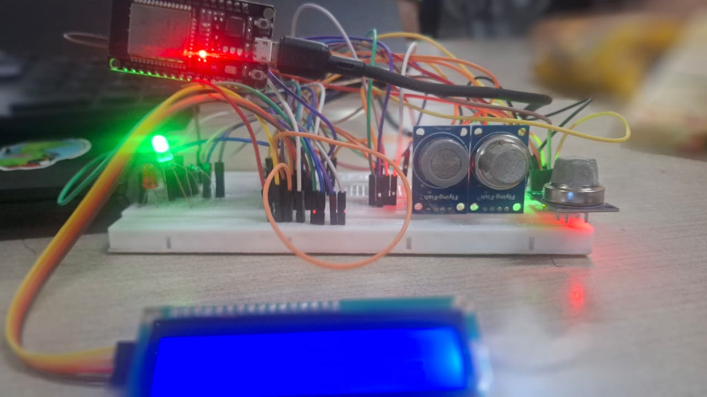
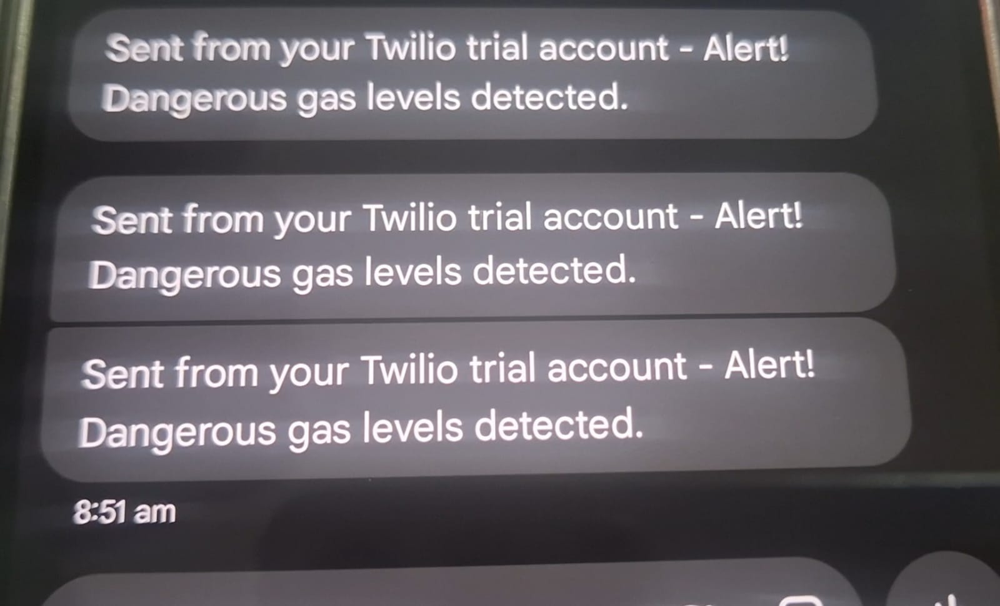

# Industrial Air Quality Monitoring and SMS Alert System

ESP32-based industrial air-quality monitoring prototype using MQ-2, MQ-135 and BME280 sensors, a 16x2 I2C LCD, Wi-Fi connectivity and Twilio SMS notifications.

## Features
- Reads raw analog values from MQ-2 and MQ-135.
- Reads temperature, humidity and pressure from BME280.
- Displays readings on a 16x2 I2C LCD.
- Sends a Twilio SMS when configured gas thresholds are exceeded.
- Uses an alert latch and recovery hysteresis to avoid repeated SMS messages.

## Hardware
- ESP32 WROOM
- MQ-2 gas/smoke sensor module
- MQ-135 air-quality sensor module
- BME280 environmental sensor
- 16x2 I2C LCD (configured for address 0x27)

## Pin configuration
The sketch contains proposed default pins: MQ-2 GPIO34, MQ-135 GPIO35, I2C SDA GPIO21 and SCL GPIO22. Verify these against the actual prototype before powering the circuit.

## Arduino libraries
Install:
- Adafruit BME280 Library
- Adafruit Unified Sensor
- LiquidCrystal_I2C (a compatible ESP32 version)

Also install/select the ESP32 board package in Arduino IDE.

## Setup
1. Open `Code/Air_Quality_Monitoring.ino` in Arduino IDE.
2. Enter Wi-Fi SSID/password and Twilio Account SID/Auth Token/from/to numbers locally in the sketch.
3. Do not commit real credentials. For a public repository, replace them with placeholders before uploading.
4. Verify wiring and sensor voltage compatibility. ESP32 GPIO inputs are not 5 V tolerant; ensure analog outputs never exceed 3.3 V.
5. Calibrate sensor thresholds for the actual modules and environment. The example thresholds are raw ADC counts, not ppm or certified safety limits.
6. Upload to ESP32 and monitor Serial output at 115200 baud.

## SMS service
The sketch sends an HTTPS POST to the Twilio Messages API. A Twilio account, valid sender number, destination permissions and sufficient account balance/credits may be required.

## Important limitations
- MQ sensor outputs require warm-up and calibration. Raw ADC values are not calibrated gas concentrations.
- This prototype is not a certified industrial safety instrument and must not replace certified gas detectors or safety systems.
- The initial example uses `tlsClient.setInsecure()` for quick testing. Replace this with certificate validation before real deployment.
- Keep credentials private. Never upload real Wi-Fi passwords, Twilio tokens or private phone numbers.

- ## Project Gallery

### Hardware Implementation

### SMS Alert Notification

### Project Demonstration
[Watch Project Demonstration Video](Images/VIDEO%20OP.mp4)

## Author
Yeshwanth V
